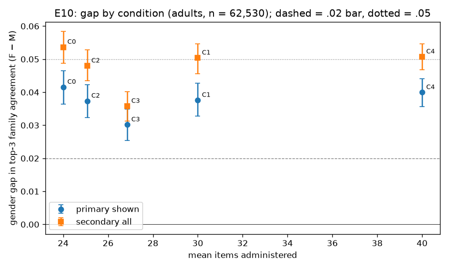

# E10 — A gender-blind mitigation for the 24-item agreement gap

Pre-registered 2026-11-17, before `research/feasibility/e10_gap_mitigation.py` has been run (ADR 0003).

**Why:** E9 found that men's 24-item results agree less with their full-test results than women's: top-3 families,
gap .044 [.039, .049] on a raw-mean proxy. Milestone 1.6(a) requires the gap to be shown within ±.05. At a feasible n
it can only be cleared if the true gap is about .02 or less (n = 1,000 per group: se ≈ .013, .05 − 2.49 × .013 ≈ .018).
ADR 0019 requires a mitigation that uses **only answers, never gender** (ADR 0015).

## Pre-registration

```
Question:      Does a gender-blind, answer-driven change to form length shrink the gender gap in top-3 family
               agreement to <= .02 without lowering either group's agreement, at a mean length of <= 30 items?
Hypothesis:    The gap comes from flatter profiles, which are more common in men (E1). Extending the form only
               for low-differentiation answers should close most of it at a small mean cost.
Data:          data/processed/riasec_people.parquet, age >= 18, complete 48 items (as E8/E9).
               Secondary: ages 13-17 (offline only; teens can't be in the 18+ study).
Engine:        src/career_compass/engine.py, unchanged (ADR 0020/0021). GRM-EAP with the E4 parameters.
               Forms: build_fixed_form(per_scale=k); the first 24 items of every longer form equal the v1 form.
               Reference ("truth") = engine profile from all 48 items.
               Families: r >= .80 (Catalogue); top-3 families = best-member rule (engine.recommend's ranking,
               before the unordered sort).
Conditions (all fixed in advance; thresholds are not tuned):
  C0  24 items for everyone (v1 today)
  C1  30 items for everyone (the refine step, MODELS L1)
  C2  24, extended to 30 when the 24-item differentiation < 1.5 (the soft-gate threshold, MODELS L3)
  C3  24, extended to all 40 retained items when the 24-item differentiation < 1.5
  C4  40 retained items for everyone (reference upper bound, not a candidate)
Population:    PRIMARY = people who are shown families: the gate (differentiation < 1.0 or elevation < 2.0)
               evaluated on the profile at each person's final length is not triggered.
               SECONDARY = everyone (as E9).
Metrics:       A3 = |top-3 families (condition) n top-3 families (48-item reference)| / 3, per person.
               Gap = mean A3 female - mean A3 male; 95% bootstrap CI (B = 1000, resampling people within group).
               Mean items administered; gate rate by group; share extended by group.
Success bar:   A condition among C1-C3 is a MITIGATION if, in the primary population:
                 (1) |gap| <= .02 (point estimate),
                 (2) neither group's mean A3 is lower than in C0 (no levelling down), and
                 (3) mean items administered <= 30.
               Recommended = the mitigation with the fewest mean items (ties: lower |gap|).
               "Proven" if at least one condition meets the bar; "not viable" otherwise. If C0 itself meets
               (1) in the primary population, report that the gate already mitigates the gap and recommend C0.
```

## Known limits, stated before running
- **Replay, not live:** answers to items 25–40 come from people who answered all 48 in one sitting.
- **The reference is the 48-item engine profile.** That includes the 8 excluded items, as in E4.
- **The gate depends on the final profile,** so the primary population differs slightly between conditions. Gate
  rates are reported so that this is visible.
- **No causal claim:** the hypothesis about why the gap exists is not tested directly.
- **Teens are a secondary, offline-only analysis.**

## Run notes
- Smoke run (`--quick`) then the full run: 62,530 adults (41,742 F, 20,347 M) and 13,059 teens, B = 1000, seed 42,
  29 s. Nothing was changed between the pre-registration commit and the run.

## Results (pre-registered)
Adults; primary population = people shown families. Gap = F − M in top-3 family agreement with the 48-item reference.

| Condition | Mean items (F / M) | Gate rate F / M | A3 F | A3 M | Gap [95% CI], primary | Gap, everyone |
|---|---|---|---|---|---|---|
| C0 24 for all | 24 | .123 / .153 | .677 | .635 | **.042** [.036, .047] | .054 |
| C1 30 for all | 30 | .125 / .153 | .719 | .681 | .038 [.033, .043] | .050 |
| C2 24 → 30 if diff < 1.5 | 25.1 (24.9 / 25.5) | .120 / .149 | .682 | .645 | .037 [.032, .042] | .048 |
| C3 24 → 40 if diff < 1.5 | 26.9 (26.3 / 28.0) | .117 / .142 | .695 | .665 | **.030** [.025, .035] | .036 |
| C4 40 for all (reference) | 40 | .126 / .147 | .801 | .761 | .040 [.036, .044] | .051 |



Extended under C2/C3: 14.4% of women and 25.0% of men (the rule is gender-blind; men's profiles are flatter more often).

Teens (secondary, offline only): C0 gap .070 [.057, .081] → C3 .054 [.042, .066]; 40 for all .052.

## Verdict
**Not viable.** No condition reaches |gap| ≤ .02. C3 comes closest (.030) and raises both groups' agreement
(F +.018, M +.029) for 2.9 extra items on average. Even 40 items for everyone leaves a .040 gap, so form length is
not the main cause.

## Post-hoc analyses (EXPLORATORY, not pre-registered; `e10_posthoc.py`, `e10_posthoc.json`)
1. **Reference check.** With a 40-item reference (no excluded DIF items), the C0 gap is .037 [.032, .042] instead
   of .042. The 40-vs-48 gap is .039. The excluded items explain only a small part.
2. **Composition check.** Among people shown families, the C0 gap is .042. Reweighting men to women's distribution
   of profile shape gives:
   - by top-2 Holland code: .033;
   - by top-2 code × differentiation band: **.011**.

   For teens the gap falls from .070 to .023.

   **Interpretation:** about three-quarters of the adult gap reflects *which* profiles men and women give, mainly
   flatter and differently shaped ones, not different treatment of similar answers. With similar answers, agreement is
   nearly equal. This fits the gender-blind design (ADR 0015): identical answers get identical results, and outcome
   differences that follow from different answers remain, as with R-top exposure in E3. It is exploratory and
   needs confirmation on an independent sample.

## Caveats
- Replay, not live; reference includes excluded items (bounded by post-hoc 1).
- Reweighting controls only for the strata used; finer shape differences may explain more of the residual or less.
- The .02 bar came from E9's power arithmetic for a raw-gap TOST. It isn't a normative fairness threshold.

## Implications
- No length-based mitigation reaches the 1.6(a) raw-gap bar. The bar's definition (raw vs answer-conditional gap) is
  an owner decision before the 1.6 study is pre-registered (ADR 0022).
- C3 is a candidate general improvement (higher agreement for everyone, smaller gap). Adopting it needs its own
  decision and a live test, because the extra items for flat profiles are replay-based.
