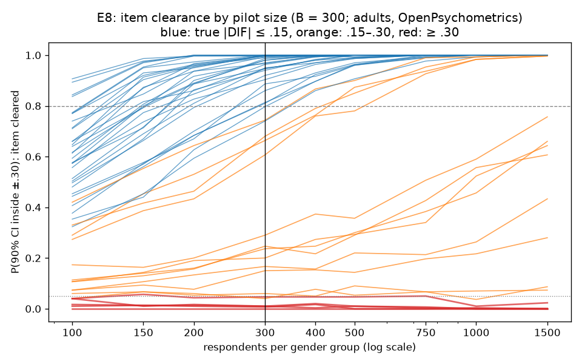

# E8 — Sample size for the item pilot's gender-DIF screen

Pre-registered 2026-11-16, before `research/feasibility/e8_pilot_power.py` has been run, with or without `--quick`. The
bar and the decision rule below are committed together with the script and are not changed afterwards (ADR 0003).

**Why:** milestone 1.1 keeps a candidate item only if its |gender DIF| is below the E2 flag of .30 SD
(`research/items/candidate_items_v1.md`). E2 judged DIF on 80k rows, where the point estimate is enough. A pilot is
much smaller, so a point estimate below .30 can happen by chance for a biased item. The pilot protocol (milestone 1.0)
needs a sample size that can show an item is clean, not only fail to show it is biased.

## Pre-registration

```
Question:      How many respondents per gender group does the research-mode item pilot need so that the E2 DIF
               method can show (90% CI inside +-.30 SD) that an item with small DIF is below the .30 flag?
Hypothesis:    Roughly 300-500 per group [our expectation, no source]. Items near the .30 flag can't be cleared at
               any realistic n, and that is intended.
Data:          data/processed/riasec_people.parquet (E1 clean rows), restricted to age >= 18, because the research
               tier is 18+ (ADR 0014). Self-reported gender 1 = male, 2 = female; other or missing excluded from DIF
               only (ADR 0015: gender is used only in offline audits). Expected about 21.5k male, 44.2k female.
Method:        "Truth" = the E2 DIF estimate for each of the 48 items on the full adult sample.
               DIF estimator, same as E2 item_dif: OLS item ~ 1 + rest + rest^2 + female, where rest is the
               standardised sum of the other 7 items on the scale; DIF = coefficient on female / item SD.
               New: an HC1 (heteroskedasticity-robust) standard error for that coefficient, also divided by the
               item SD, gives a 90% Wald CI.
               Check before the power grid: the vectorised estimator must reproduce the E2 JSON gender DIF on the
               full sample of all ages to 3 decimals (all 48 items), or the run stops.
               Power grid: n per group in {100, 150, 200, 300, 400, 500, 750, 1000, 1500}, equal groups,
               B = 300 resamples per n (sampling without replacement within each gender), seed 42.
Items:         "Clean" = true |DIF| <= .15. "Flagged" = true |DIF| >= .30. Others are "near the flag" (reported only).
Metrics:       Per item and n: P(cleared) = P(90% CI entirely inside (-.30, .30)).
               M1 clean items: share of clean items with P(cleared) >= .80.
               M2 flagged items: max P(cleared) (false clearance).
               M3 CI calibration: share of replicates whose 90% CI contains the true value (pooled over items).
               M4 median 90% CI half-width.
               M5 per-scale Cronbach alpha 95% interval width (2.5th-97.5th percentile over replicates), both
                  groups pooled (2n people), as a secondary precision report.
Baselines:     None needed; this is a planning simulation. The full-sample E2 estimate is the reference.
Decision rule: Recommended n per group = the smallest grid n with M1 >= .90 AND M2 <= .05.
               If no grid n meets it, the result is "not reachable at <= 1500 per group" and the protocol must use
               another screening rule (decided in a new ADR, not here).
Verdict:       This is a planning result, not a feasibility test: "recommended n = X" or "not reachable".
               M3 between .85 and .95 is required to trust the result; outside that range the verdict is
               "CI not calibrated; result not usable" whatever M1 and M2 show.
```

## Known limits, stated before running
- The 26 candidates have no data. The simulation uses the 48 existing items as stand-ins and assumes the new items
  behave like them (similar SD, rest-score relation, DIF spread). That's an assumption, not evidence.
- The pilot form will have 74 items (48 + 26), so rest scores differ from the 8-item scales used here.
- **Teen age DIF can't be screened in an 18+ pilot.** E2 flagged age DIF between 13–17 and 25+ (S1, R6). The adult
  pilot can only test 18–24 vs 25+. Screening for teens needs approved research with minors (ADR 0014, blocker 1).
- OpenPsychometrics is a self-selected online sample, 67% female (E1). Equal groups are a design target for the
  pilot (quota sampling), not something this data shows is achievable.
- Respondents who don't disclose gender, or who give another answer, add to the total sample but not to the
  DIF groups. The total recruitment target therefore depends on a disclosure rate we don't know yet.
- This covers gender DIF only. The milestone 1.6 fairness audit and the 1.7 usability pilot need their own power
  analyses.

## Run notes (disclosed)
- The first `--quick` smoke run crashed when writing the JSON (`numpy.bool_` isn't JSON-serialisable). Fix after the
  pre-registration commit: `e2_check` now returns `float(...)` and `bool(...)`. No computation changed. The smoke
  outputs were deleted; the full run used the fixed script unchanged otherwise.
- The E2 reproduction check passed: max difference .001 at 3 decimals over 48 items (rounding).
- Full run: 62,089 complete adult rows (41,742 female, 20,347 male), B = 300, seed 42, 21 s.

## Results
Adult "true" DIF (full adult sample): 31 clean items (|DIF| ≤ .15), 5 flagged (R3 −.38, A7 −.35, I8 −.34, E1 −.31,
E4 +.42), 12 near the flag. R4 is −.295 among adults (−.32 on all ages in E2), so it counts as near the flag here.

| n per group | M1 clean items with P(cleared) ≥ .80 | M2 max P(cleared), flagged | M3 90% CI coverage | M4 median CI half-width |
|---|---|---|---|---|
| 100 | .129 | .040 | .898 | .186 |
| 150 | .516 | .057 | .903 | .151 |
| 200 | .774 | .043 | .904 | .131 |
| **300** | **.935** | **.047** | .901 | .107 |
| 400 | 1.000 | .047 | .903 | .092 |
| 500 | 1.000 | .047 | .899 | .083 |
| 750 | 1.000 | .050 | .904 | .067 |
| 1000 | 1.000 | .010 | .909 | .058 |
| 1500 | 1.000 | .023 | .905 | .048 |



- **M2 is set by E1 (true −.31),** cleared 4–5% of the time at every n. That is what a 90% CI does to an item just
  over the flag (about 5% one-sided), so M2 ≤ .05 holds at almost any n and adds little.
- **Near-flag items are rarely cleared.** At n = 300: A3 (.24) .24, S4 (−.23) .25, E5 (−.24) .20, E6 (.24) .29,
  S2 (.28) .15, C4 (.29) .04. The pilot will leave items like these **inconclusive**, not cleared.
- At n = 300 the weakest clean item is cleared with P = .74 (2 of 31 clean items fall under .80). At n = 400 every
  clean item is ≥ .86.
- M5: at n = 300 per group (600 pooled), the 95% interval for per-scale α (8-item scales) is .03–.05 wide (median α
  .83–.89), enough to check the α ≥ .80 bar of milestone 1.2.

## Verdict
**Recommended n = 300 per gender group** (pre-registered rule: smallest n with M1 ≥ .90 and M2 ≤ .05; CI coverage
.90 at every n, so the CI is calibrated).

## Interpretation (ours, not part of the rule)
- 300 is the **minimum**. It just meets M1 (.935) and leaves two clean items below .80. **400 per group** gives a
  margin (all clean items ≥ .86) for about a third more recruitment, and also covers the new items behaving a little
  worse than the old ones. We suggest the protocol plans 400 and treats 300 as the floor below which the DIF screen
  isn't run.
- The rule clears items, it doesn't just fail to flag them. Under it, an item with real DIF of about .20–.25 usually ends up
  inconclusive at pilot scale. The retention bar therefore needs three outcomes (cleared, flagged, inconclusive).
  Inconclusive items aren't retained unless they're needed for content coverage, and if so they're named in the
  re-audit (ADR 0018).
- Only respondents who report male or female count towards these 300–400 per group. Total recruitment = 2 × n_group
  plus everyone else, divided by the disclosure rate, which is unknown until the pilot.

## Caveats
- The new items are assumed to behave like the 48 old ones (see "Known limits" above); the pilot form is longer (74 items).
- Equal-group resampling from a self-selected online sample; real pilot recruitment may not reach balanced groups.
- Teen age DIF is not covered (18+ tier). Gender DIF only; milestones 1.6 and 1.7 need separate power analyses.
- Uniform DIF only, as in E2; non-uniform DIF is not estimated.

## Implications
- Pilot protocol (milestone 1.0): at least 300, planned 400, adults per self-reported gender group, plus a recruitment
  margin for non-disclosure.
- Retention bar (milestone 1.1): a candidate is cleared only when its 90% CI for gender DIF lies inside ±.30 (ADR 0018).
